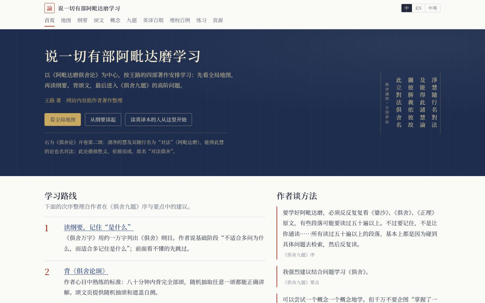
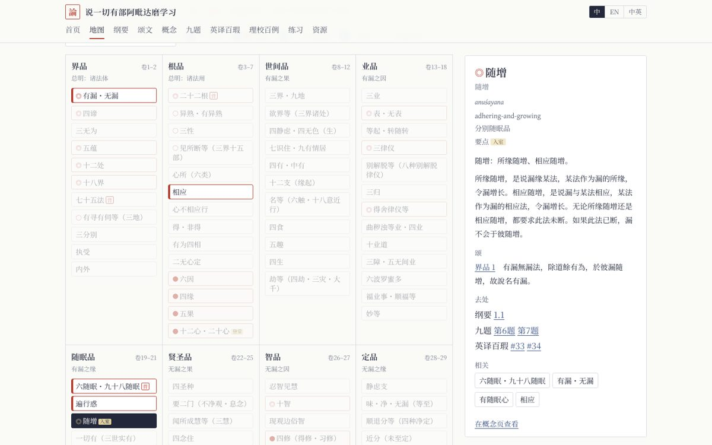

# 说一切有部阿毗达磨学习 · Sarvāstivāda Abhidharma

以王路的四部阿毗达磨著作为骨架，围绕《阿毗达磨俱舍论》搭建的学习网站：先看全局地图，再读纲要、背颂文，最后进入《俱舍九题》的高阶问题。必要内容配有英文，供中文不熟练的读者理解《俱舍》的重点和难点。

**在线访问：<https://wanglu2016.github.io/abhidharma/>**

[全部著作书目](https://github.com/wanglu2016/wanglu-books) · [王路文集](https://github.com/wanglu2016/wanglu-writings)



## 网站内容

| 页面 | 内容 |
| --- | --- |
| [全局地图](https://wanglu2016.github.io/abhidharma/map.html) | 按普光《俱舍论记》的框架画出九品结构（总明／别明有漏、无漏之果因缘），并把《九题》〈术语要点一览〉中的 89 个概念排成地图。重要性只按作者原话标注：要点◎、难点●、基本操作○、入门必背、登堂／入室等关口。点选概念即显示定义、颂文、去处和相关概念。 |
| [纲要](https://wanglu2016.github.io/abhidharma/outline.html) | 《俱舍万字》全文，逐段英译；配七十五法、三界九地、九十八随眠、二十二根、因缘果、四向四果、十二缘起等图表。 |
| [颂文](https://wanglu2016.github.io/abhidharma/verses.html) | 《俱舍论颂》全文（CBETA T1560），可按品筛选、随机抽一颂、遮盖自测。 |
| [概念](https://wanglu2016.github.io/abhidharma/concepts.html) | 全部概念的简体、繁体、梵语、英文对照，释义凡见于《万字》者照录原文，附颂文和《九题》《百瑕》去处。 |
| [九题导读](https://wanglu2016.github.io/abhidharma/jiuti.html) | 九题的三个阶段、各节标题与页码（点击直接打开 PDF 对应页）、入门测验、问题拆分示例。 |
| [英译百瑕](https://wanglu2016.github.io/abhidharma/translations.html) | 一百条的索引：颂号、Pruden 与 Lodrö Sangpo 页码、英文提要、中文要旨，可按品和译本筛选。 |
| [理校百例](https://wanglu2016.github.io/abhidharma/emendations.html) | 按论典列出每例的卷次、CBETA 位置与页码。 |
| [练习](https://wanglu2016.github.io/abhidharma/genpin-1.html) | 原“分别根品测试一”，题目和答案不变，增加逐题判分、显示答案和开卷参考表。 |
| [资源](https://wanglu2016.github.io/abhidharma/resources.html) | 著作下载、典籍简称表、在线检索工具。 |

界面右上角可切换 **中 / EN / 中英**。



## 著作下载

| 著作 | 下载 |
| --- | --- |
| 《俱舍九题：高阶阿毗达磨串讲》 | [PDF](https://github.com/wanglu2016/abhidharma/raw/main/books/%E4%BF%B1%E8%88%8D%E4%B9%9D%E9%A1%8C%E9%9B%BB%E5%AD%90%E6%9B%B8.pdf) |
| 《俱舍万字》《俱舍英译百瑕》《阿毗达磨理校百例》合订稿（2025-04-01） | [PDF](https://github.com/wanglu2016/abhidharma/raw/main/books/%E3%80%8A%E4%BF%B1%E8%88%8D%E8%90%AC%E5%AD%97%E3%80%8B%E3%80%8A%E4%BF%B1%E8%88%8D%E8%8B%B1%E8%AD%AF%E7%99%BE%E7%91%95%E3%80%8B%E3%80%8A%E9%98%BF%E6%AF%98%E9%81%94%E7%A3%A8%E7%90%86%E6%A0%A1%E7%99%BE%E4%BE%8B%E3%80%8B250401.pdf) |
| 整个网站的离线版（含两份 PDF） | [abhidharma-site.zip](https://github.com/wanglu2016/abhidharma/raw/main/download/abhidharma-site.zip) |

离线版解压后双击 `index.html` 即可使用，不需要联网。

## 注意事项

- 中文内容取自作者著作；英文译文、《百瑕》英文提要和图表由网站整理，供阅读参考。如有出入，以作者原文和玄奘译语为准。
- 概念的重要性标记只依据作者在《俱舍九题》〈术语要点一览〉中的原话；未见于《俱舍万字》的概念，释义由编者据《俱舍》撰写，页面上已分别注明。
- 颂序号按 CBETA 本四句一颂顺序编排，仅供本站检索，与梵本及英译本的偈颂编号不完全一致。
- 勘误请寄作者：cuechin@163.com。

## 数据来源与许可

| 内容 | 来源 | 许可 |
| --- | --- | --- |
| 《俱舍九题》《俱舍万字》《英译百瑕》《理校百例》 | 王路著，本仓库 `books/` | 版权归作者 |
| 《阿毘达磨俱舍论本颂》 | CBETA 电子佛典 T29, no. 1560 | CBETA：非商业使用 |
| 九品结构 | 普光《俱舍论记》卷1（T41, no. 1821, p. 1c16–2a19） | CBETA：非商业使用 |
| Noto Serif SC（按页面用字裁剪） | [notofonts/noto-cjk](https://github.com/notofonts/noto-cjk) | SIL OFL 1.1，见 `assets/fonts/OFL-NotoSerifSC.txt` |
| Gentium Plus（按页面用字裁剪） | [google/fonts](https://github.com/google/fonts/tree/main/ofl/gentiumplus) | SIL OFL 1.1，见 `assets/fonts/OFL-GentiumPlus.txt` |

## 目录结构

```
index.html  map.html  outline.html  verses.html  concepts.html
jiuti.html  translations.html  emendations.html  genpin-1.html  resources.html
assets/     css、js、裁剪后的字体、图标与截图
books/      两份 PDF（保留作者原文件名）
download/   离线版 zip
src/        内容源数据：概念、《万字》英译、《百瑕》提要、《九题》结构，以及从 PDF 和 CBETA 提取的 JSON
tools/      提取、生成页面、裁剪字体、截图检查的脚本（见 tools/README.md）
```

## 本地运行

```bash
python3 -m http.server 8000
# 浏览器打开 http://localhost:8000/
```

修改内容后重新生成页面：编辑 `src/` 中的文件，然后运行 `python3 tools/build.py`（步骤见 [tools/README.md](tools/README.md)）。
